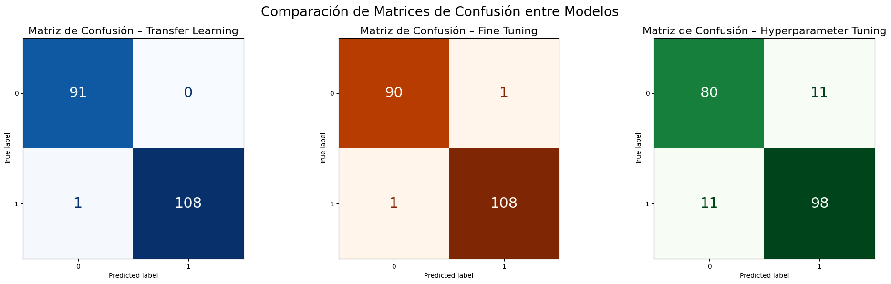

# Applied ML notebooks

Image classification and spam detection projects from U-tad's Artificial Intelligence course.

[Project walkthrough (PowerPoint)](docs/applied-ml-notebooks.pptx)

| Project | Notebook | Kaggle |
| --- | --- | --- |
| Cats vs. dogs | [Image classification with CNNs and EfficientNetB0](notebooks/cats-vs-dogs.ipynb) | [Original notebook](https://www.kaggle.com/code/jorgesu040/cyd-intro-cnn) |
| Spam detection | [Text classification with LSTMs and BERT](notebooks/spam-classification.ipynb) | — |

## Cats vs. dogs

I trained a CNN from scratch, searched its hyperparameters with Hyperband and compared it with an EfficientNetB0 feature extractor and a fine-tuned version. The experiment used 2,000 images, with 200 held out for testing.

| Model | Test accuracy |
| --- | ---: |
| CNN tuned with Hyperband | 89.0% |
| EfficientNetB0 feature extractor | **99.5%** |
| Fine-tuned EfficientNetB0 | 99.0% |



## Spam detection

I compared an LSTM, a BiLSTM, a BiLSTM with pretrained GloVe embeddings and a BERT classifier. The comparison uses a decision threshold of 0.8. MCC is the Matthews correlation coefficient.

| Model | Accuracy | Precision | Recall | MCC |
| --- | ---: | ---: | ---: | ---: |
| LSTM | 83.10% | 68.38% | 60.15% | 0.5320 |
| BiLSTM | 93.24% | 84.40% | 89.47% | 0.8238 |
| BiLSTM + GloVe | 93.62% | 85.36% | **89.85%** | 0.8331 |
| BERT | **95.31%** | **91.86%** | 89.10% | **0.8736** |

The LSTM tokenizer was fitted before the train/test split. [BERT training curves](docs/spam-bert-training-curves.png)

## Run the notebooks

Use Python 3.12 on Linux or WSL for the shared TensorFlow and Keras NLP environment.

```sh
python -m pip install -r requirements.txt
python -m jupyter lab
```

- **Cats vs. dogs.** Put labelled images in `data/Cats_Dogs/cat` and `data/Cats_Dogs/dog`, or set `CATS_DOGS_DIR`. Use a balanced dataset large enough for the training, validation and test splits. The optional external-image demo reads `data/external-test`. Graphviz is optional for plotting the model architecture. EfficientNetB0 downloads the ImageNet weights on first use.
- **Spam.** Put `train.csv`, `test.csv` and `sample_submission.csv` in `data/Spam_Data`, or set `SPAM_DATA_DIR`. Training needs `row_id,text,spam_label`, with 0 for non-spam and 1 for spam. Prediction input needs `row_id,text` and the output template needs `row_id,spam_label`. See the [CSV examples](examples/spam/). The GloVe and BERT cells download their public pretrained weights on first use.
